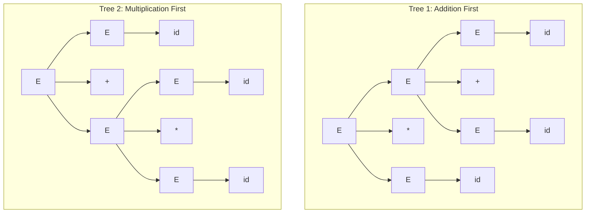

# Case Study 1: Arithmetic Expression Validation

## 1. Formal Language and Objectives

Arithmetic expressions form the syntactic foundation of high-level programming languages. This case study demonstrates lexical analysis, recursive descent parsing, concrete parse-tree generation, leftmost/rightmost derivations, operator precedence, associativity enforcement, and ambiguity resolution.

### Supported Alphabet $\Sigma$:
- Identifiers: $[a-zA-Z\_][a-zA-Z0-9\_]*$ (e.g. `id`, `x`, `count`)
- Numeric Literals: $[0-9]+(\.[0-9]+)?$ (e.g. `42`, `3.14`)
- Operators: `+`, `-`, `*`, `/`
- Parentheses: `(`, `)`

---

## 2. Context-Free Grammar Definition

### The Stratified Precedence Grammar:
$$G = (V, \Sigma, R, E)$$
- **Variables $V$**: $\{E, T, F\}$
- **Terminals $\Sigma$**: $\{+, -, *, /, (, ), \text{id}, \text{num}\}$
- **Start Symbol**: $E$
- **Production Rules $R$**:
  $$E \to E + T \mid E - T \mid T$$
  $$T \to T * F \mid T / F \mid F$$
  $$F \to (E) \mid \text{id} \mid \text{num}$$

### Design Rationale:
1. **Precedence Hierarchy**:
   - $E$ represents expressions at the lowest precedence level (`+`, `-`).
   - $T$ represents terms at intermediate precedence level (`*`, `/`).
   - $F$ represents factors at the highest precedence level (atomic `id`, `num`, or parenthesized `(E)`).
   Because $T$ is located deeper in the parse tree than $E$, operations `*` and `/` are evaluated prior to `+` and `-`.

2. **Associativity Enforcement**:
   - Left-recursive productions $E \to E + T$ and $T \to T * F$ group operations strictly left-to-right:
     $$10 - 4 - 2 \Rightarrow ((10 - 4) - 2) = 4 \quad (\text{never } 10 - (4 - 2) = 8)$$

---

## 3. Ambiguity Analysis and Resolution

### The Ambiguous Grammar (Classical Problem):
$$E \to E + E \mid E * E \mid \text{id}$$

For input string `id + id * id`, this grammar produces **two distinct parse trees**:

#### Tree 1: Evaluating `+` First
- Structure: $E \to E * E$, where left $E \to E + E$
- Semantics: $(id + id) * id$
- Numeric Example ($id_1=2, id_2=3, id_3=4$): $(2 + 3) \times 4 = 20$

#### Tree 2: Evaluating `*` First (Standard Precedence)
- Structure: $E \to E + E$, where right $E \to E * E$
- Semantics: $id + (id * id)$
- Numeric Example ($id_1=2, id_2=3, id_3=4$): $2 + (3 \times 4) = 14$

### Resolution:
Stratifying into $E \to E + T \mid T$, $T \to T * F \mid F$, and $F \to (E) \mid \text{id}$ completely eliminates ambiguity. For `id + id * id`, **only Tree 2 can be generated**. The grammar is proven unambiguous without altering the underlying arithmetic language.

---

## 4. Top-Down Pushdown Automaton Model

Every context-free grammar can be simulated by a Pushdown Automaton $M = (Q, \Sigma, \Gamma, \delta, q_{start}, Z_0, \{q_{acc}\})$:
1. Initialize stack: $\delta(q_{start}, \varepsilon, Z_0) = (q_{loop}, EZ_0)$
2. Top-down expansion of nonterminals:
   - $\delta(q_{loop}, \varepsilon, E) = \{(q_{loop}, E+T), (q_{loop}, E-T), (q_{loop}, T)\}$
   - $\delta(q_{loop}, \varepsilon, T) = \{(q_{loop}, T*F), (q_{loop}, T/F), (q_{loop}, F)\}$
   - $\delta(q_{loop}, \varepsilon, F) = \{(q_{loop}, (E)), (q_{loop}, \text{id}), (q_{loop}, \text{num})\}$
3. Matching input against terminals on stack:
   - $\delta(q_{loop}, a, a) = (q_{loop}, \varepsilon) \quad \forall a \in \Sigma$
4. Final acceptance on empty marker:
   - $\delta(q_{loop}, \varepsilon, Z_0) = (q_{acc}, Z_0)$

---

## 5. Test Case Suite

### Accepted Expressions:
1. `id + id * id` — Demonstrates precedence (* over +).
2. `(id + id) * id` — Parenthesized override of operator precedence.
3. `10 + 20 * 30 - 40 / 2` — Mixed operators and numeric literals.
4. `((a + b) * (c - d)) / e` — Deep nested parentheses.
5. `x` — Minimal atomic factor token.
6. `a + b + c + d` — Left-associative chain validation.

### Rejected Expressions:
1. `id + * id` — Missing operand between consecutive binary operators.
2. `(id + id` — Unclosed opening parenthesis at EOF.
3. `id + id)` — Stray closing parenthesis.
4. `+ id * id` — Leading binary operator with missing left operand.
5. `id + id *` — Trailing binary operator with missing right operand.
6. `id + @num` — Illegal lexical character `@`.
