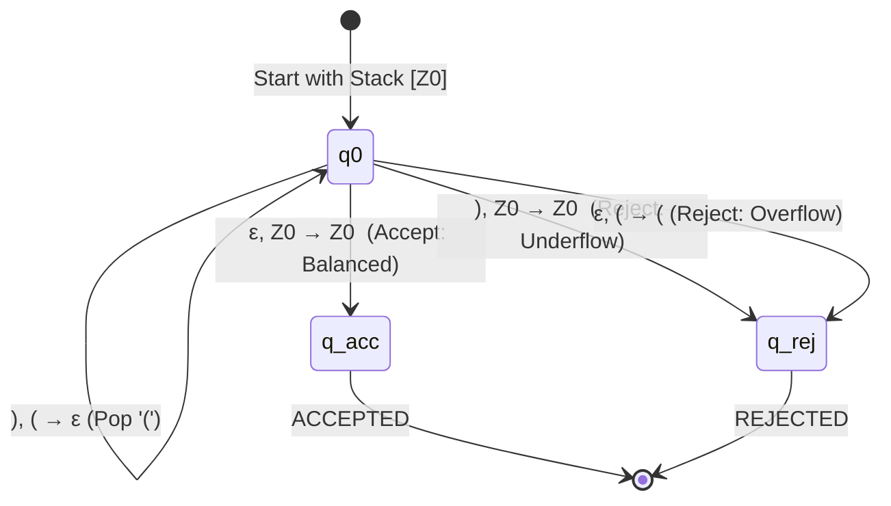

# Case Study 2: Balanced Parentheses Checking

## 1. Formal Language Definition

The language of balanced parentheses (known as the **Dyck Language** $D_1$) is defined as:
$$L = \{ w \in \{(,)\}^* \mid w \text{ contains balanced, properly nested parentheses} \}$$

---

## 2. Context-Free Grammar Specification

$$G = (\{S\}, \{(, )\}, R, S)$$

### Production Rules:
$$S \to (S)S \mid \varepsilon$$

### Example Derivations:
- For `()`:
  $$S \Rightarrow (S)S \Rightarrow (\varepsilon)S \Rightarrow ()S \Rightarrow ()\varepsilon \Rightarrow ()$$
- For `(())`:
  $$S \Rightarrow (S)S \Rightarrow ((S)S)S \Rightarrow ((\varepsilon)S)S \Rightarrow (()S)S \Rightarrow (())S \Rightarrow (())$$

---

## 3. Deterministic Pushdown Automaton (DPDA) Model

Because every opening parenthesis uniquely requires a push and every closing parenthesis uniquely requires a pop, this language is a **Deterministic Context-Free Language (DCFL)**.

### Formal 7-Tuple:
$$M = (Q, \Sigma, \Gamma, \delta, q_0, Z_0, F)$$
- $Q = \{q_0, q_{acc}, q_{rej}\}$
- $\Sigma = \{(, )\}$
- $\Gamma = \{Z_0, (\}$
- Initial State: $q_0$
- Initial Stack Symbol: $Z_0$
- Accepting States: $F = \{q_{acc}\}$

### Transition Function $\delta$:
1. **Push Opening Parenthesis**:
   $$\delta(q_0, '(', Z_0) = (q_0, (Z_0)$$
   $$\delta(q_0, '(', '(') = (q_0, ((')$$
2. **Pop Matching Closing Parenthesis**:
   $$\delta(q_0, ')', '(') = (q_0, \varepsilon)$$
3. **Reject on Stack Underflow (Premature Closing)**:
   $$\delta(q_0, ')', Z_0) = (q_{rej}, Z_0)$$
4. **Accept on Clean Stack Return**:
   $$\delta(q_0, \varepsilon, Z_0) = (q_{acc}, Z_0)$$
5. **Reject on Stack Overflow (Unclosed Opening Parentheses)**:
   $$\delta(q_0, \varepsilon, '(') = (q_{rej}, '(')$$

---

## 4. Stack Trace Walkthrough for `(()())`

| Step | State | Read Char | Stack Before | Operation | Stack After | Description |
| :---: | :---: | :---: | :---: | :---: | :---: | :--- |
| **0** | $q_0$ | START | `[Z0]` | INIT | `[Z0]` | Machine initialized |
| **1** | $q_0$ | `(` | `[Z0]` | PUSH `(` | `[Z0, (]` | First opening parenthesis |
| **2** | $q_0$ | `(` | `[Z0, (]` | PUSH `(` | `[Z0, (, (]` | Nested opening parenthesis |
| **3** | $q_0$ | `)` | `[Z0, (, (]` | POP `(` | `[Z0, (]` | Matched inner `)` |
| **4** | $q_0$ | `(` | `[Z0, (]` | PUSH `(` | `[Z0, (, (]` | Sibling opening parenthesis |
| **5** | $q_0$ | `)` | `[Z0, (, (]` | POP `(` | `[Z0, (]` | Matched sibling `)` |
| **6** | $q_0$ | `)` | `[Z0, (]` | POP `(` | `[Z0]` | Matched outer `)` |
| **7** | $q_{acc}$ | $\varepsilon$ | `[Z0]` | ACCEPT | `[Z0]` | All consumed, stack returns to $Z_0$ |

---

## 5. Test Case Suite

### Accepted Inputs:
1. `()` — Minimal single pair.
2. `(())` — Simple nesting.
3. `()()()` — Sequential adjacent pairs.
4. `((()()))` — Nested sibling combination.
5. `(()(()))()` — Irregular multi-level balanced nesting.
6. `""` (empty string) — Formally in $L$ via $S \to \varepsilon$.

### Rejected Inputs:
1. `(` — Stack overflow at EOF (unclosed parenthesis).
2. `)` — Stack underflow at start (unmatched closing).
3. `)(` — Equal delimiter counts but inverted sequence.
4. `(()))` — Too many closing parentheses.
5. `((()` — Too many opening parentheses.
6. `(()[()])` — Invalid symbol `[` not in alphabet $\Sigma = \{(, )\}$.
