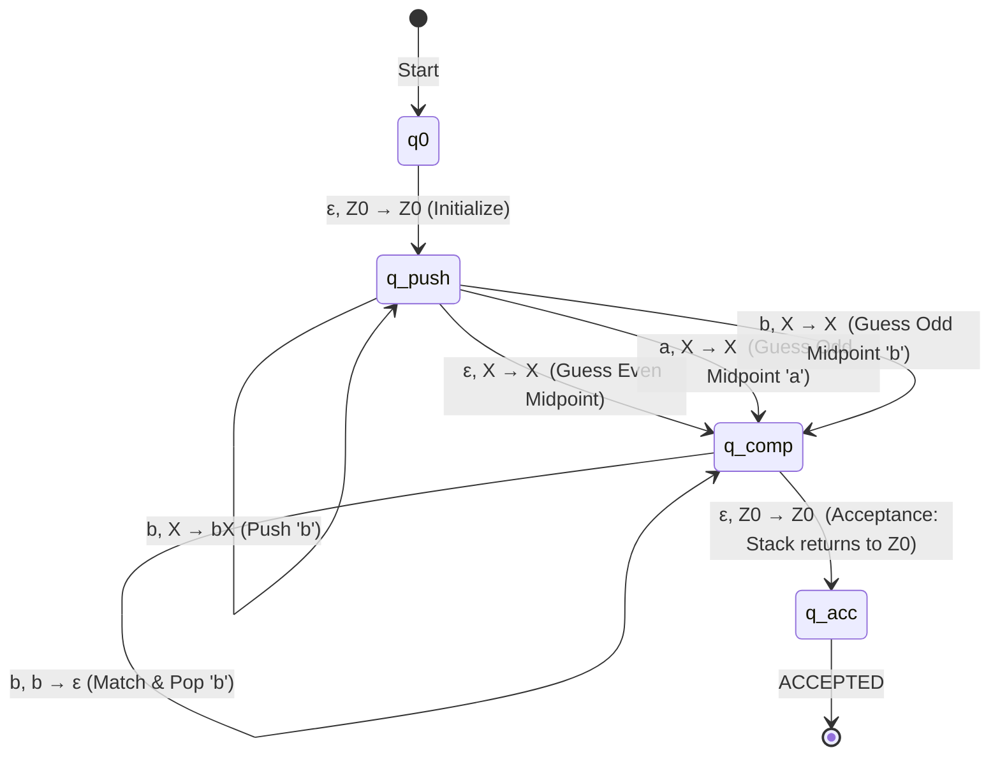

# Case Study 3: Palindrome Language Recognition

## 1. Formal Language Definition

The language of palindromes over alphabet $\Sigma = \{a, b\}$ is:
$$L = \{ w \in \{a, b\}^* \mid w = w^R \}$$
where $w^R$ denotes the reverse of string $w$.

The language includes both:
- **Even-length palindromes** ($|w| = 2k$, e.g. `abba`, `baab`, `ε`)
- **Odd-length palindromes** ($|w| = 2k+1$, e.g. `aba`, `a`, `baabaab`)

---

## 2. Context-Free Grammar Specification

$$G = (\{S\}, \{a, b\}, R, S)$$

### Production Rules:
$$S \to a S a \mid b S b \mid a \mid b \mid \varepsilon$$

### Derivation Examples:
- Even palindrome `abba`:
  $$S \Rightarrow aSa \Rightarrow abSba \Rightarrow ab\varepsilon ba = abba$$
- Odd palindrome `aba`:
  $$S \Rightarrow aSa \Rightarrow aba$$

---

## 3. Why Palindromes Require a Nondeterministic PDA (NPDA)

A fundamental result of Automata Theory establishes that:
$$\text{DPDA} \subsetneq \text{NPDA}$$
The language $L = \{w w^R \mid w \in \{a,b\}^*\}$ is a **non-deterministic context-free language (CFL \ DCFL)**.

### Theoretical Proof:
Suppose for contradiction that a DPDA $M$ exists for $L$.
Consider strings of the form $a^n b a^n \in L$. The automaton must remember the number of initial $a$'s by pushing them onto its stack.
However, for an arbitrary input $a^{2n}$, the prefix $a^n a^n$ is a palindrome, but the overall string $a^{2n} b a^{2n}$ is also a palindrome with a later center!
Because there is no distinct marker indicating the center of the string, a deterministic machine has no bounded lookahead capable of knowing when to stop pushing and start popping. If it transitions into pop mode too early, it rejects valid longer palindromes; if it stays in push mode too long, it exhausts the input and rejects valid shorter palindromes.

Therefore, **an NPDA exploring all midpoint branches concurrently is strictly necessary**.

---

## 4. Formal NPDA Specification

### 7-Tuple:
$$M = (Q, \Sigma, \Gamma, \delta, q_0, Z_0, \{q_{acc}\})$$
- $Q = \{q_0, q_{push}, q_{comp}, q_{acc}\}$
- $\Sigma = \{a, b\}$
- $\Gamma = \{Z_0, a, b\}$
- Start state: $q_0$
- Initial stack symbol: $Z_0$
- Final state: $q_{acc}$

### Transition Function $\delta: Q \times (\Sigma \cup \{\varepsilon\}) \times \Gamma \to \mathcal{P}(Q \times \Gamma^*)$:
1. **Initialize Machine**:
   $$\delta(q_0, \varepsilon, Z_0) = \{(q_{push}, Z_0)\}$$
2. **Push First Half**:
   $$\delta(q_{push}, a, X) \ni (q_{push}, aX) \quad \forall X \in \Gamma$$
   $$\delta(q_{push}, b, X) \ni (q_{push}, bX) \quad \forall X \in \Gamma$$
3. **Nondeterministic Midpoint Guesses**:
   - **Even-length midpoint guess**:
     $$\delta(q_{push}, \varepsilon, X) \ni (q_{comp}, X)$$
   - **Odd-length midpoint guess** (reads center character without pushing):
     $$\delta(q_{push}, a, X) \ni (q_{comp}, X)$$
     $$\delta(q_{push}, b, X) \ni (q_{comp}, X)$$
4. **Compare and Pop Second Half**:
   $$\delta(q_{comp}, a, a) = \{(q_{comp}, \varepsilon)\}$$
   $$\delta(q_{comp}, b, b) = \{(q_{comp}, \varepsilon)\}$$
5. **Acceptance on Input Exhaustion & Empty Stack**:
   $$\delta(q_{comp}, \varepsilon, Z_0) = \{(q_{acc}, Z_0)\}$$

---

## 5. Breadth-First Configuration Exploration

Our implementation uses actual configuration tree exploration $(q, \text{index}, \text{stack})$.
For string `abba`:
- **Branch 1 (Midpoint at 0)**: Jumps to $q_{comp}$ with empty stack; reads 'a' $\to$ mismatch with $Z_0 \implies$ dead end.
- **Branch 2 (Odd midpoint 'a' at 0)**: Consumes 'a'; reads 'b' in $q_{comp}$ with stack $Z_0 \implies$ dead end.
- **Branch 3 (Push 'a', then even midpoint at 1)**: Stack $[Z_0, a]$, reads 'b' in $q_{comp} \implies$ mismatch with 'a', dies.
- **Branch 4 (Push 'a', push 'b', then even midpoint at 2)**: Stack $[Z_0, a, b]$. Reads 'b' $\to$ pops 'b'. Reads 'a' $\to$ pops 'a'. At EOF, stack contains $Z_0 \implies$ **ACCEPTED (WINNER)**!

---

## 6. Test Case Suite

### Accepted Inputs:
1. `abba` — Classic 4-char even palindrome.
2. `aba` — Classic 3-char odd palindrome.
3. `a` — Minimal 1-char odd palindrome.
4. `ababbaba` — 8-char complex even palindrome.
5. `baabaab` — 7-char complex odd palindrome.
6. `""` (empty string) — 0-char even palindrome.

### Rejected Inputs:
1. `ab` — Asymmetric 2-char string.
2. `aab` — Asymmetric odd string.
3. `bbaa` — Transposed string ($ww$ instead of $ww^R$).
4. `abaa` — Trailing extra symbol.
5. `abbabb` — Repeated word.
6. `abcba` — Illegal character `c` $\notin \{a, b\}$.
